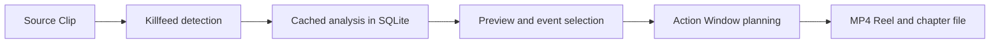

## Summary

This pull request improves VALORANT highlight detection and montage assembly, and adds a Docker Compose configuration for running LazyCut on Windows with Docker Desktop.

### Highlight detection and editing

- Track individual killfeed rows across frames to reduce duplicate detections and distinguish closely spaced kills. Record headshot status for each detected event.
- Reuse the same analysis for Preview and Montage Jobs. Invalidate the cache when the Source Clip or detection inputs change, and update event records and clip statistics in one transaction.
- Allow users to preview and select individual events, set lead-in and lead-out durations, and specify a maximum Reel length.
- Preserve a selected event when shortening an Action Window. Generate chapters and kill counts from the final cut list.

### Docker deployment

- Add a Docker image, Compose configuration, and Windows launcher. Start the Studio with `start-docker.bat` or `docker compose up --build --detach --wait`, then open `http://127.0.0.1:8000/`.
- Mount Source Clips read-only, keep SQLite in a persistent Docker volume, and write exported Reels to the host `exports/` directory.
- Use polling to detect new Source Clips on the host mount and encode video with `libx264`. Game Process Guard is disabled in the container because it cannot observe the Windows game process.

## Evidence

| Area | Previous behavior | Verification |
| --- | --- | --- |
| Event detection | Time-based debounce could group consecutive kills into a single event. | Regression tests verify that a shifted row is matched to its existing event while a new row is counted separately. |
| Analysis reuse | Preview and Montage Jobs analyzed the same Source Clip independently. | Regression tests verify cache reuse and replacement of stale events after a Source Clip changes. |
| Duration limits | Shortening an Action Window from its start could remove the kill frame. | Regression tests verify that a shortened cut retains a selected kill and that chapters reflect the final cut. |
| Docker operation | Docker had no project entry point. | A container smoke test detected and analyzed a synthetic recording, rendered a two-second 9:16 MP4, and served it for download. The Studio returned HTTP 200 after restart and retained its SQLite database. |

**Test suite:** 50 passed and 1 skipped in Docker with Python 3.13. The skipped test requires a local VALORANT recording.

**Validation scope:** Accuracy on full VALORANT matches and performance against Outplayed Supercut require a side-by-side benchmark with real footage.

## Merge impact

**Rollback:** Reversible. The database change adds an analysis cache table. Existing Source Clips can be analyzed on demand, and the Docker launcher is opt-in.

**Affected areas:** Source Clip ingestion and analysis, Preview, Montage Jobs, Reel metadata, and local Docker deployment.